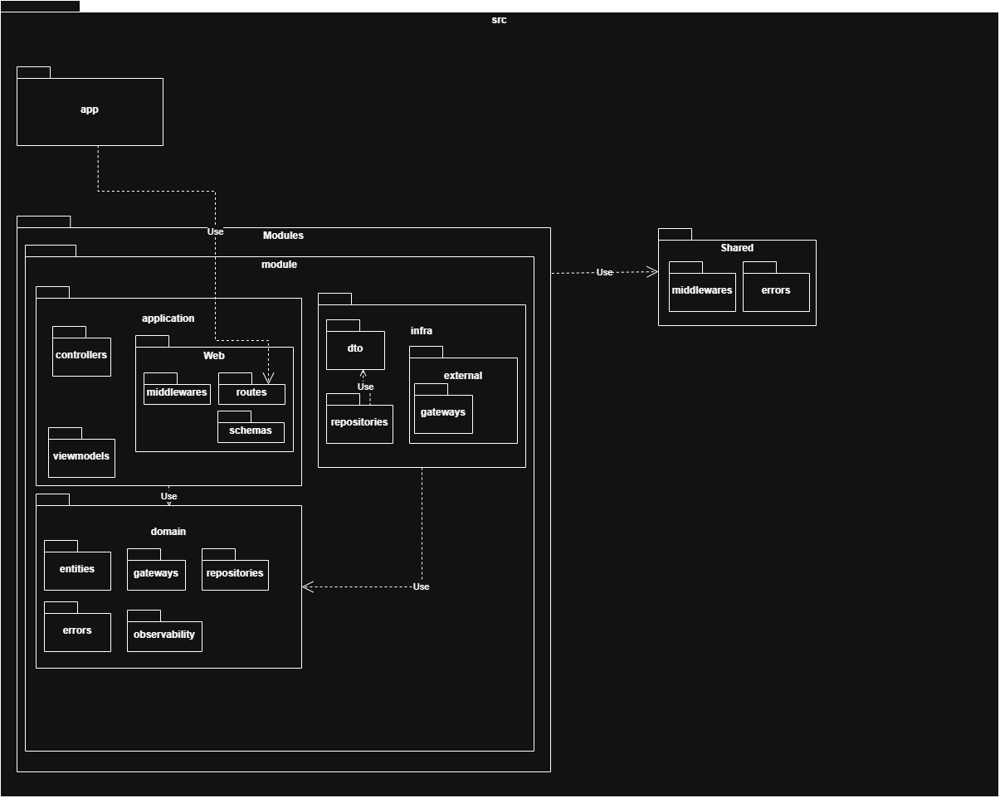

# Template Clean Architecture

Template de projeto organizado por **módulos**, com cada módulo dividido em camadas (`application`, `domain`, `infra`) seguindo os princípios de Clean Architecture.

## Estrutura do projeto

```
.
├───docs
├───iac
├───src
│   ├───app
│   ├───modules
│   │   └───example_module
│   │       ├───application
│   │       │   ├───controllers
│   │       │   ├───viewmodels
│   │       │   └───web
│   │       │       ├───middlewares
│   │       │       ├───routes
│   │       │       └───schemas
│   │       ├───domain
│   │       │   ├───entities
│   │       │   ├───errors
│   │       │   ├───gateways
│   │       │   ├───observability
│   │       │   └───repositories
│   │       └───infra
│   │           ├───dto
│   │           ├───external
│   │           │   └───gateways
│   │           └───repositories
│   └───shared
│       ├───errors
│       └───middlewares
└───tests
    ├───app
    ├───modules
    │   └───example_module
    │       ├───application
    │       │   ├───controllers
    │       │   ├───viewmodels
    │       │   └───web
    │       │       ├───middlewares
    │       │       ├───routes
    │       │       └───schemas
    │       ├───domain
    │       │   ├───entities
    │       │   ├───errors
    │       │   ├───gateways
    │       │   ├───observability
    │       │   └───repositories
    │       └───infra
    │           ├───dto
    │           ├───external
    │           │   └───gateways
    │           └───repositories
    └───shared
        ├───errors
        ├───middlewares
        └───utils
```

## Camadas de um módulo

### `application/`
Ponto de entrada do módulo. Conhece HTTP e orquestra o fluxo, mas não contém regra de negócio.

| Pasta | Responsabilidade |
|---|---|
| `web/routes` | Declara as rotas (método + path) e delega para os controllers. Um arquivo por recurso, mais um `index` que exporta o roteador do módulo. |
| `web/schemas` | Formato de entrada e saída da API (validação de body, query e path params). |
| `web/middlewares` | Middlewares específicos do módulo (ex.: permissão própria). Os globais ficam em `shared/middlewares`. |
| `controllers` | Recebe os dados já validados, orquestra o caso de uso, chama repositórios e gateways e devolve o resultado. |
| `viewmodels` | Monta a resposta final enviada ao cliente, inclusive combinando dados de mais de uma fonte. |

### `domain/`
Coração do módulo. **Não conhece HTTP, banco de dados nem frameworks.**

| Pasta | Responsabilidade |
|---|---|
| `entities` | Objetos de negócio e suas regras. |
| `errors` | Erros de domínio (ex.: `XNotFoundError`). A camada web converte em status HTTP. |
| `repositories` | Interfaces (contratos) de persistência. |
| `gateways` | Interfaces (contratos) para dados ou serviços de outros contextos/módulos. |
| `observability` | Interfaces de logging, métricas e tracing usadas pelo domínio. |

### `infra/`
Implementações concretas dos contratos do domínio.

| Pasta | Responsabilidade |
|---|---|
| `repositories` | Implementação dos repositórios (banco de dados). Converte modelo de persistência ↔ entidade. |
| `external/gateways` | Implementação dos gateways (outro módulo, API externa etc.). |
| `dto` | Formato de dados de persistência e de serviços externos. Veja a seção "Formatos de dados". |

### `shared/`
Código usado por mais de um módulo: erros base (`AppError`, `NotFoundError`, `ValidationError`) e middlewares globais (logging, CORS, autenticação geral, tratamento global de erros). Crie novas pastas (`config`, `utils`, `types`) apenas quando houver necessidade real.

## Regra de dependência

As dependências sempre apontam para dentro, em direção ao domínio:

```
application  ──►  domain  ◄──  infra
```

- `domain` **nunca** importa de `application` nem de `infra`.
- `infra` implementa as interfaces definidas em `domain`.
- `application` usa as interfaces do `domain`; as implementações concretas são injetadas na composição (`src/app`).
- Módulos **não importam entidades uns dos outros**. A comunicação entre módulos acontece por gateways (veja abaixo).

## Formatos de dados

Cada borda tem o seu próprio formato, e a **entidade** é a língua comum entre eles:

| Formato | Onde fica | Sufixo sugerido |
|---|---|---|
| Entrada/saída da API | `application/web/schemas` | `Request`, `Response` |
| Persistência (tabela/documento) | `infra` | `Model` |
| Payload de serviço externo | `infra/external` | `Dto` |

Regras:

- `web/schemas` nunca é importado em `infra`, e formatos de `infra` nunca são devolvidos direto pela rota.
- A conversão acontece nas bordas: repositórios convertem `Model ↔ Entidade`, e viewmodels/schemas de resposta convertem `Entidade → Response`.
- Ter `Request`, `Entidade` e `Model` parecidos é esperado. É o custo de manter as camadas independentes; não reaproveite uma classe só para evitar repetição.

## Relacionamento entre entidades

| Situação | Solução |
|---|---|
| A entidade filha não existe sem a mãe (ex.: `X` e `XItem`) | Mesmo aggregate, **um repositório só** para o aggregate root. |
| Uma entidade precisa que outra exista, mas ambas vivem sozinhas (ex.: `X` e `Y`) | Aggregates separados. A entidade guarda apenas o **ID** da outra, e a existência é validada no controller. |
| A outra entidade está em outro módulo | O módulo que precisa declara uma interface em `domain/gateways`, e a implementação fica em `infra/external/gateways`. |

### Exemplo: X precisa de Y

```
modules/
├── y/                                     # domínio próprio de Y
└── x/
    ├── domain/
    │   ├── entities/x.*                   # guarda apenas y_id
    │   ├── errors/y_not_found_error.*
    │   └── gateways/y_gateway.*           # interface: exists(y_id)
    └── infra/
        └── external/gateways/
            └── y_gateway_impl.*           # única classe que conhece o módulo y
```

O nome do gateway reflete o **papel que ele cumpre para o módulo** (`YGateway`), não o módulo de origem.

## Onde colocar cada coisa

| Preciso de... | Coloque em... |
|---|---|
| Uma nova rota | `application/web/routes` |
| Validar o body de uma requisição | `application/web/schemas` |
| Autorização válida só para um módulo | `application/web/middlewares` |
| Middleware válido para todo o app | `shared/middlewares` |
| Uma regra de negócio | `domain/entities` |
| Um novo erro de negócio | `domain/errors` |
| Contrato de acesso a dados | `domain/repositories` |
| Contrato para falar com outro módulo/serviço | `domain/gateways` |
| Implementação de acesso a dados | `infra/repositories` |
| Implementação de chamada externa | `infra/external/gateways` |
| Erro base reutilizável | `shared/errors` |

## Convenções

- **Nomes de pastas no plural** (`entities`, `errors`, `gateways`, `repositories`, `controllers`).
- **Sufixos consistentes** nos tipos: `Request`, `Response`, `Model`, `Dto`, `Gateway`, `Repository`.
- **Erros de domínio não conhecem HTTP**: o mapeamento para status code fica na camada `web`.
- **Crie pastas só quando precisar**: evite pastas vazias ou com um único arquivo sem perspectiva de crescimento.

## Testes

A pasta `tests/` espelha a estrutura de `src/`, para que o teste de qualquer arquivo seja fácil de encontrar:

```
tests/
└── modules/
    └── example_module/
        ├── application/
        ├── domain/
        └── infra/
```

- **Domínio**: testes unitários puros, sem mocks de framework.
- **Controllers**: testes com repositórios e gateways substituídos por dobles (fakes/mocks).
- **Infra**: testes de integração (banco, serviços externos).

## Como criar um novo módulo

1. Copie `src/modules/example_module` para `src/modules/<nome_do_modulo>`.
2. Defina as entidades e erros em `domain`.
3. Declare as interfaces necessárias (`repositories`, `gateways`) em `domain`.
4. Implemente as interfaces em `infra`.
5. Crie controllers, schemas e viewmodels em `application`.
6. Declare as rotas em `application/web/routes` e exporte o roteador pelo `index`.
7. Registre o roteador do módulo em `src/app`.
8. Crie os testes correspondentes em `tests/modules/<nome_do_modulo>`.

## Diagrama de Pacotes do Template
